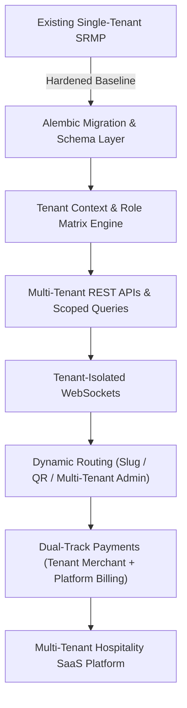
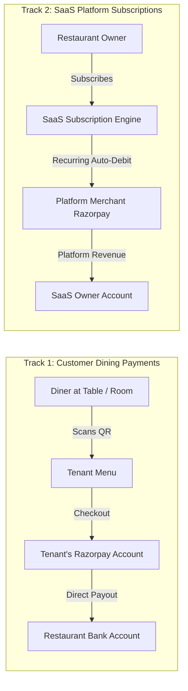
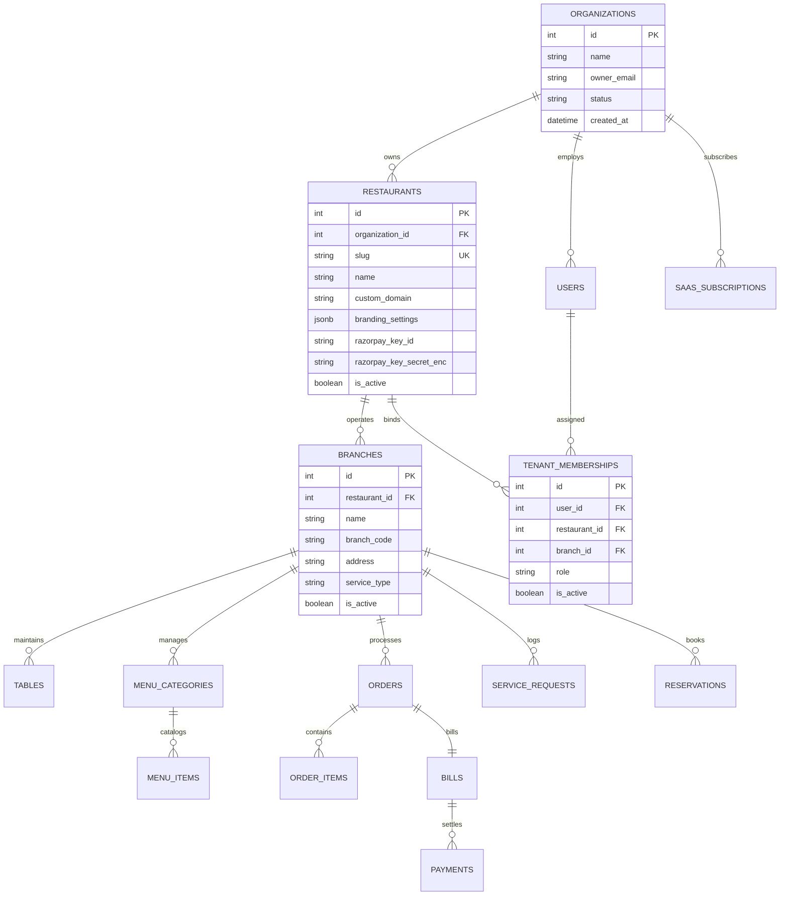

# MULTI-TENANT RESTAURANT & HOTEL SAAS CONVERSION
## Architecture Gap Analysis & Technical Implementation Blueprint

**Project**: Smart Restaurant Management Platform (SRMP)  
**Baseline Brand**: The Royal Saffron (Single-Tenant Baseline)  
**Target Architecture**: Enterprise Multi-Tenant Restaurant & Hotel Hospitality SaaS Platform  
**Git Checkpoint**: `pre-multitenant-deployment` (`763d2dd`)  
**Database Snapshot**: `backups/smart_restaurant_backup_20261110_105301.db` (SHA256 verified)  
**Date**: November 10, 2026  

---

## 1. Executive Summary & Audit Baseline

The existing Smart Restaurant Management Platform (SRMP) was developed and hardened as a single-organization application featuring 40 passing end-to-end and security automated tests, 12 responsive interfaces, and sustained 100-user concurrency.

To evolve SRMP into a commercial hospitality SaaS product serving multiple independent restaurants, hotel food-and-beverage outlets, and multi-branch chains, this audit evaluates the delta between the current single-tenant implementation and a zero-trust multi-tenant SaaS architecture.

---

## 2. Comprehensive Codebase Gap Analysis

### 2.1 Database Models & Entity Relations

| Domain | Current State (Single-Tenant Baseline) | Multi-Tenant SaaS Requirement | Architectural Gap & Risk |
|---|---|---|---|
| **Tenant Model** | `Restaurant` has basic contact, tax, and wifi fields with `id=1`. No slug, no organization grouping. | Add `Organization` (parent enterprise), `Branch` (physical outlets / hotel zones), and `Restaurant` with unique URL `slug`. | **Critical**: Cannot route public web traffic by tenant without unique slugs or custom domain mapping. |
| **Role Hierarchy** | Flat `UserRole`: `ADMIN`, `MANAGER`, `WAITER`, `KITCHEN`, `CASHIER`. | Partition into **Platform Roles** (`SUPER_ADMIN`, `PLATFORM_SUPPORT`) and **Tenant Roles** (`RESTAURANT_OWNER`, `MANAGER`, `CASHIER`, `WAITER`, `KITCHEN_STAFF`). | **Critical Privilege Escalation**: A restaurant admin can currently execute operations across all restaurants because role checks don't assert tenant ownership. |
| **Service Points** | `Table` has `table_number` and table status. | Support restaurants and hotels (`service_type`: `TABLE`, `ROOM_SERVICE`, `POOL_BAR`, `BANQUET`). | Hotels need service points with room numbers and delivery zones rather than traditional dining tables. |
| **Tenant FKs & Indexing** | Models have `restaurant_id = Column(Integer, default=1)`. | Composite foreign keys, compound indexes `(tenant_id, id)` and unique constraints `(tenant_id, slug)`, `(tenant_id, table_number)`. | Lack of composite unique constraints permits cross-tenant namespace collisions. |

---

### 2.2 API Routers & Query Isolation

| Router | File Path | Existing Query Behavior | Multi-Tenant Vulnerability | Remediation Required |
|---|---|---|---|---|
| **Menu** | `backend/app/routers/menu.py` | `db.query(MenuCategory).all()` | **Data Leak**: All diners view all categories across every tenant in the database. | Filter strictly by `category.restaurant_id == tenant_id`. |
| **Orders** | `backend/app/routers/orders.py` | Accepts `order_data.restaurant_id` from client JSON payload. | **Spoofing**: Malicious client can place orders under arbitrary tenant IDs. | Derive `tenant_id` authoritatively from validated QR session token or staff JWT context. |
| **Kitchen (KDS)** | `backend/app/routers/kitchen.py` | `db.query(Order).filter(Order.status.in_(...)).all()` | **Data Leak**: Kitchen display displays active orders across all restaurants. | Restrict active orders to `Order.restaurant_id == current_staff.restaurant_id`. |
| **Analytics** | `backend/app/routers/analytics.py` | `db.query(func.sum(Payment.amount)).all()` | **Critical Information Disclosure**: Admin overview reports aggregate revenue of all SaaS competitors. | Scope every aggregation filter by `tenant_id`. |
| **Tables** | `backend/app/routers/tables.py` | `db.query(Table).all()` | Floor plan renders all tables across all restaurant accounts. | Scope floor queries by `branch_id` and `tenant_id`. |

---

### 2.3 Real-Time WebSocket Channel Segregation

* **Current Vulnerability**: `ConnectionManager` manages global rooms: `"kitchen"`, `"staff"`, `"admin"`.
* **Exploitation Vector**: A chef or waiter in Restaurant B subscribing to `/ws/kitchen` receives live WebSockets containing order updates, items, customer names, and table IDs from Restaurant A.
* **Target Architecture**:
  * Namespace all channels: `/ws/tenant/{tenant_id}/{channel}`.
  * Require JWT bearer token validating user membership in `tenant_id` during the connection handshake.
  * Table-specific sockets scoped to: `/ws/tenant/{tenant_id}/table/{table_id}`.

---

### 2.4 Payment Architecture (Dual-Track Model)

The platform must maintain two completely distinct payment lifecycles:

1. **Track 1: Tenant-Specific Customer Payments**:
   - Each restaurant configures their own merchant credentials (`razorpay_key_id`, encrypted `razorpay_key_secret`) in their Restaurant Settings.
   - When a dining customer pays their bill, the order is created on that restaurant's specific Razorpay account.
2. **Track 2: SaaS Platform Subscription Billing**:
   - Platform collects monthly/annual software fees (Starter, Pro, Enterprise tiers) from restaurant owners.
   - Separate subscription billing models, trial tracking, and automated tenant account deactivation/downgrade upon non-payment.

---

## 3. Multi-Tenant Entity Relationship Diagram (ERD)

---

## 4. Step-by-Step Implementation Roadmap

### Phase 1.1: Database Schema Expansion & Alembic Migration
1. Author Alembic migration adding `organizations`, `branches`, `tenant_memberships`, and `saas_subscriptions`.
2. Add `slug` (indexed, unique), `organization_id`, and encrypted gateway credentials to `restaurants`.
3. Migrate existing Royal Saffron seed data safely into `id=1, slug="royal-saffron"` with 0 data loss.

### Phase 1.2: Tenant Context Resolution & Role-Based Middleware
1. Build `TenantContext` dependency in FastAPI:
   - For public endpoints: Resolves tenant by path slug `/{tenant_slug}` or signed QR code.
   - For authenticated endpoints: Resolves tenant and branch from user's verified `tenant_memberships`.
2. Enforce tenant isolation in all database sessions: Prevent query execution without tenant predicate.
3. Update `UserRole` enum with `SUPER_ADMIN`, `PLATFORM_SUPPORT`, `RESTAURANT_OWNER`, `MANAGER`, `CASHIER`, `WAITER`, `KITCHEN_STAFF`.

### Phase 1.3: Router Scoping & Query Hardening
1. Refactor `menu.py`, `orders.py`, `kitchen.py`, `tables.py`, `billing.py`, `analytics.py`, `reservations.py`, and `service_requests.py` to require tenant context.
2. Ensure no client-supplied `restaurant_id` is ever trusted from HTTP body or query parameters.

### Phase 1.4: Real-Time WebSocket Tenant Namespacing
1. Refactor `ConnectionManager` to partition rooms by tenant: `tenant_{id}_{channel}`.
2. Require JWT token handshake validation verifying user membership in `tenant_id` before accepting socket connections.

### Phase 1.5: Frontend Dynamic Tenant Routing
1. Update `App.tsx` router with `/:tenantSlug/menu`, `/:tenantSlug/table/:qrToken`, and `/:tenantSlug/track/:orderId`.
2. Build Super Admin Platform portal at `/platform` for tenant onboarding, subscription management, and system-wide metrics.
3. Add Tenant/Branch switcher in Admin navigation for multi-branch restaurant owners.

### Phase 1.6: Automated Isolation Verification & Regression Suite
1. Create `backend/tests/test_multi_tenant_isolation.py`:
   - Tenant B staff attempting to access Tenant A orders -> `403/404`.
   - Tenant B kitchen attempting to connect to Tenant A kitchen WebSocket -> `Policy Violation (1008)`.
   - Tenant A menu updates invisible to Tenant B customers.
2. Run full 40-test baseline regression to ensure 100% backward compatibility for existing features.

