# SRMP — Production-Grade Razorpay Architecture & Setup Guide

This guide details the complete production architecture, security controls, and step-by-step dashboard configurations for operating the Smart Restaurant Management Platform (SRMP) with two strictly separated payment flows.

---

## 1. Architectural Topology: Two Strictly Separated Flows

```mermaid
flowchart TD
    subgraph FlowA["FLOW A: Restaurant Customer Orders (Tenant-Isolated)"]
        Customer["Dine-In Customer (Table QR)"] -->|"1. Orders Food & Drink"| SRMP_Order["SRMP Order & Bill (DB Authoritative)"]
        SRMP_Order -->|"2. Razorpay Order (Paise)"| RZP_Rest["Restaurant Razorpay Merchant Account"]
        Customer -->|"3. UPI / Card / NetBanking"| RZP_Rest
        RZP_Rest -->|"4. Direct Settlement (T+1)"| Rest_Bank["Restaurant's Settlement Bank Account"]
        RZP_Rest -.->|"5. Signed Webhook (HMAC SHA256)"| SRMP_Webhook_Rest["/api/v1/payments/webhook/restaurant/:id"]
        SRMP_Webhook_Rest -->|"6. Idempotent Deduplication"| Rest_Ledger["Restaurant Bills & Payments Ledger"]
    end

    subgraph FlowB["FLOW B: SRMP SaaS Subscriptions (Platform Level)"]
        RestOwner["Restaurant Owner / Hotellier"] -->|"1. Selects Plan (Starter/Pro/Ent)"| SRMP_Sub["SaaS Billing Engine (18% GST)"]
        SRMP_Sub -->|"2. Platform Razorpay Order"| RZP_Platform["SRMP Platform Razorpay Merchant Account"]
        RestOwner -->|"3. Pays Subscription Fee"| RZP_Platform
        RZP_Platform -->|"4. Platform Settlement (T+2)"| Platform_Bank["SRMP SaaS Business Bank Account"]
        RZP_Platform -.->|"5. Signed Webhook (HMAC SHA256)"| SRMP_Webhook_Platform["/api/v1/subscriptions/webhook"]
        SRMP_Webhook_Platform -->|"6. Idempotent Activation"| Sub_Ledger["Platform Subscription Ledger & Invoices"]
    end
```



> [!IMPORTANT]
> **Zero Cross-Account Mixing Guarantee**: 
> - Customer food/beverage payments settle directly to the restaurant's own merchant account. They **never** pass through the platform's subscription account.
> - Restaurant SaaS subscription billing settles directly to the SRMP platform's corporate bank account.

---

## 2. Platform Owner Setup (SaaS Business — Individual / Unregistered Model)

The Platform Owner operates the central multi-tenant SaaS business as an **individual / unregistered business** (unless incorporated/GST credentials are later configured) and collects tax-inclusive subscription fees (₹999/month, ₹9,999/year).

### Step 2.1: Platform Account Registration & Individual Business KYC
1. Register a Razorpay merchant account at [dashboard.razorpay.com](https://dashboard.razorpay.com/) under **Individual / Sole Proprietor**.
2. Submit authentic KYC documents under **SaaS / IT Services / Cloud Software**:
   - Individual PAN card of the platform owner.
   - Cancelled cheque or bank statement for the owner's verified individual bank account (do not fabricate corporate CIN/GSTIN if unregistered).
   - Authorized signatory / owner Aadhaar/identity proof.
3. In **Settings -> Bank Account**, link the owner's verified individual bank account. All SaaS subscription revenues settle here.

### Step 2.2: Generate Platform API Keys
1. In the Razorpay Dashboard, navigate to **Settings -> API Keys**.
2. Select **Generate Test Key** for staging (keep `LIVE_MODE_FLOW_B=false` until KYC approval).
3. Store the credentials securely in the SRMP backend environment:
   ```env
   PLATFORM_RAZORPAY_KEY_ID="rzp_test_xxxxxxxxxxxxxxxx"
   PLATFORM_RAZORPAY_KEY_SECRET="your_platform_key_secret"
   PLATFORM_SETTLEMENT_ACCOUNT="VERIFIED_INDIVIDUAL_BANK_REF"
   BUSINESS_OPERATING_MODEL="INDIVIDUAL_UNREGISTERED"
   ```

### Step 2.3: Configure Platform Subscriptions Webhook
1. In the Dashboard, navigate to **Settings -> Webhooks**.
2. Click **+ Add New Webhook**.
3. Set **Webhook URL** to your production domain:
   ```
   https://api.yourdomain.com/api/v1/subscriptions/webhook
   ```
4. Enter a strong random secret and copy it to `.env`:
   ```env
   PLATFORM_RAZORPAY_WEBHOOK_SECRET="your_platform_webhook_secret_here"
   ```
5. Select the following mandatory subscription events:
   - `order.paid`
   - `payment.captured`
   - `payment.failed`
   - `subscription.cancelled`
6. Save the webhook.

---

## 3. Restaurant Owner Setup (Direct Merchant Account)

Each restaurant owner connects their own independent Razorpay merchant account so that table orders settle directly to their restaurant bank account without intermediary handling.

### Step 3.1: Restaurant Razorpay Onboarding & Food Service KYC
1. The restaurant owner creates their own Razorpay account at [dashboard.razorpay.com](https://dashboard.razorpay.com/).
2. Completes restaurant KYC under **Food & Beverage / Restaurant & Cafe**:
   - FSSAI License.
   - Restaurant GST Certificate.
   - Restaurant Current Bank Account details (IFSC & Account number).

### Step 3.2: Generate Restaurant Merchant API Keys
1. In their Razorpay Dashboard, the owner navigates to **Settings -> API Keys**.
2. Generates **Key ID** and **Key Secret**.
3. Opens the SRMP Restaurant Management Portal at `https://app.yourdomain.com/admin/settings`.
4. Under the **Payment Gateway (Razorpay)** tab:
   - Enters **Razorpay Key ID** (`rzp_live_...`).
   - Enters **Razorpay Key Secret**.
   - Selects **Gateway Mode**: `DIRECT_MERCHANT`.
   - Clicks **Save Gateway Configuration**.
   - *Note: SRMP automatically encrypts secrets at rest using authenticated Fernet AES.*

### Step 3.3: Configure Restaurant Order Webhook
1. In the restaurant's Razorpay Dashboard, go to **Settings -> Webhooks**.
2. Click **+ Add New Webhook**.
3. Set **Webhook URL** to:
   ```
   https://api.yourdomain.com/api/v1/payments/webhook/restaurant/{RESTAURANT_ID}
   ```
4. Enter a secret, and paste the same secret into **Razorpay Webhook Secret** in the SRMP Settings page.
5. Select the following customer payment events:
   - `payment.captured`
   - `order.paid`
   - `payment.failed`
   - `refund.processed`
6. Save the webhook.

---

## 4. Alternative: Razorpay Route (Linked Accounts)

If the platform is approved for **Razorpay Route**, restaurants can alternatively be linked as sub-merchants under the platform's umbrella account.

| Feature | Direct Merchant (Default) | Razorpay Route (Linked Accounts) |
|---|---|---|
| **Account Ownership** | Restaurant owns their Razorpay account | Platform manages linked accounts (`acc_...`) |
| **KYC Responsibility** | Restaurant completes their own KYC | Platform or sub-merchant through Route API |
| **Settlement Path** | Direct from gateway to restaurant bank | Automated split transfer via Route API |
| **Platform Commission** | Billed separately via SaaS subscription (Flow B) | Automatic split fee deduction at time of capture |
| **Chargeback Liability** | Restaurant handles their chargebacks | Platform handles dispute routing |
| **Eligibility** | Instant (any verified restaurant) | Requires Razorpay enterprise approval |

### Configuring Route in SRMP:
1. In `admin/settings`, set **Gateway Mode** to `RAZORPAY_ROUTE`.
2. Input the restaurant's Route Account ID: `acc_xxxxxxxxxxxx`.
3. When creating orders, SRMP will automatically attach `transfers: [{account: "acc_...", amount: amount_paise}]`.

---

## 5. Security, Verification & Idempotency Architecture

### 1. Authoritative Backend Calculation
- Customer clients never submit arbitrary payment amounts.
- Total bill amounts, GST taxes, and service charges are calculated authoritatively on the backend by summing active items and customizations from database records.

### 2. Cryptographic Signature Verification
Payment callbacks are validated using HMAC SHA256 in constant time (`hmac.compare_digest`):
$$\text{Expected Signature} = \text{HMAC-SHA256}(\text{order\_id} + \text{"|"} + \text{payment\_id}, \text{Secret})$$
Frontend success callbacks without a matching cryptographic signature are rejected with HTTP 400.

### 3. Webhook Raw-Body Verification
Webhooks are verified using the unparsed raw request body bytes:
$$\text{Webhook Signature} = \text{HMAC-SHA256}(\text{Raw Body Bytes}, \text{Webhook Secret})$$

### 4. Idempotency & Fault Tolerance
- **Duplicate Protection**: Every processed webhook event ID is recorded in `payment_webhook_events` (Flow A) or `subscription_webhook_events` (Flow B) with a unique constraint. Duplicate deliveries return HTTP 200 immediately without executing duplicate state changes.
- **Out-of-Order Events**: If a webhook arrives before the frontend verification callback, the webhook captures the payment and records the transaction. Subsequent callbacks detect the existing transaction ID and return an idempotent success response.
- **Refund Tracking**: Partial and full refunds call the gateway's refund endpoint and adjust the bill status (`PAID` -> `PARTIAL` or `UNPAID`).

---

## 6. Pre-Live Production Smoke Checklist

Before switching any environment from `test` to `live`:
- [ ] Platform owner's Razorpay account is fully KYC verified with active settlement bank account.
- [ ] Restaurant's Razorpay account is fully KYC verified.
- [ ] All API keys in `.env` and tenant records start with `rzp_live_`.
- [ ] Webhook endpoints are configured with HTTPS and valid SSL certificates.
- [ ] Test a live ₹1.00 transaction on a real restaurant table QR and verify settlement in the restaurant's bank account.
- [ ] Test a live ₹1.00 SaaS subscription checkout and verify settlement in the platform's corporate bank account.
- [ ] Confirm no secrets or keys are committed to Git.

