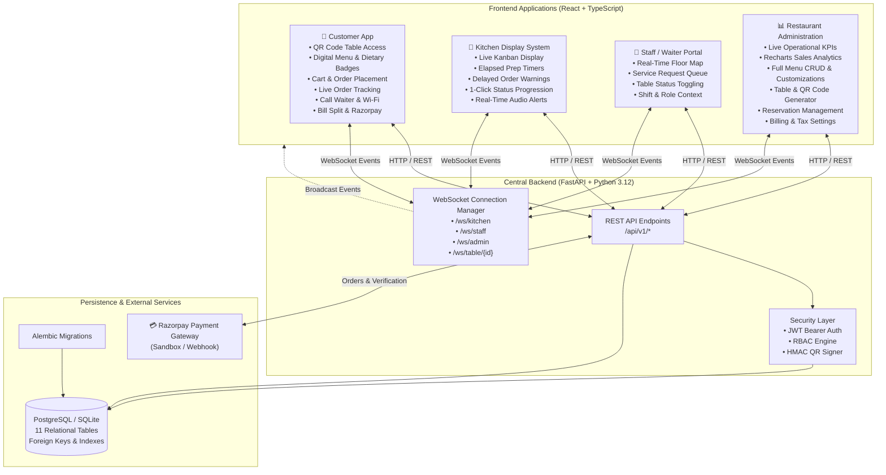

# Smart Restaurant Management Platform (SRMP)
### Enterprise Multi-Portal Hospitality Ecosystem

A unified, real-time restaurant management platform connecting **Customers**, **Kitchen Staff**, **Waiters**, and **Restaurant Administrators** through a single high-performance system.

Built from scratch using:
- **Frontend**: React 19, TypeScript, Vite, Tailwind CSS, Lucide Icons, Recharts, React Router
- **Backend**: Python 3.12, FastAPI, WebSockets, SQLAlchemy 2.0 ORM, Pydantic v2
- **Database**: PostgreSQL (Production) / SQLite (Local Fast-Boot), Alembic Migrations
- **Payment Gateway**: Razorpay (Sandbox & Production Webhooks)
- **Security**: JWT Authentication, Role-Based Access Control (RBAC), Cryptographic HMAC Table QR Tokens

---

## 🏛️ System Architecture



---

## 🚀 Quick Start Guide

### 1. Prerequisites
- **Node.js** (v18+)
- **Python** (v3.10+)

### 2. Backend Setup
```bash
cd backend

# Create virtual environment
python -m venv venv

# Activate virtual environment
# Windows:
.\venv\Scripts\activate
# Linux/macOS:
source venv/bin/activate

# Install dependencies
pip install -r requirements.txt

# Seed initial data (automatic on first run, or run manually)
python -m app.utils.seed_data

# Start FastAPI server
uvicorn app.main:app --host 0.0.0.0 --port 8000 --reload
```
API Documentation will be live at: `http://localhost:8000/docs`

### 3. Frontend Setup
```bash
cd frontend

# Install npm dependencies
npm install

# Start Vite development server
npm run dev
```
Frontend will be accessible at: `http://localhost:5173`

---

## 🔑 Default Seed Credentials

The database automatically seeds with realistic restaurant staff profiles:

| Role | Username | Email | Password | Access Rights |
|------|----------|-------|----------|---------------|
| **Admin** | `admin` | `admin@royalsaffron.com` | `admin123` | Full administrative control, analytics, menu CRUD, settings |
| **Manager** | `manager` | `manager@royalsaffron.com` | `manager123` | Operations, table assignments, floor, reservations, menu |
| **Waiter** | `waiter` | `waiter@royalsaffron.com` | `waiter123` | Floor map, service requests, order assistance, bill delivery |
| **Kitchen** | `chef` | `chef@royalsaffron.com` | `chef123` | Kitchen Display System, preparation timers, status updates |
| **Cashier** | `cashier` | `cashier@royalsaffron.com` | `cashier123` | Billing settlements, cash/card payment records, receipts |

---

## 📱 Portals & Application Routes

- `/table/:qrToken` - **Customer Application** (Mobile-first QR dining experience)
- `/table/:qrToken/cart` - **Shopping Cart & Checkout**
- `/table/:qrToken/track/:orderId` - **Live Order Tracker**
- `/table/:qrToken/wifi` - **Guest Wi-Fi Connection Information**
- `/table/:qrToken/split-bill` - **Bill Splitting & Tip Calculator**
- `/table/:qrToken/service` - **Call Waiter & Service Requests**
- `/table/:qrToken/reserve` - **Table Reservation Request**
- `/kitchen` - **Kitchen Display System (KDS)**
- `/staff` - **Staff & Waiter Portal**
- `/admin` - **Restaurant Administration Hub**
  - `/admin/overview` - Dynamic Operational KPIs
  - `/admin/analytics` - Sales Trends & Category Charts
  - `/admin/menu` - Menu & Customizations Manager
  - `/admin/tables` - Floor Map & Table QR Generator
  - `/admin/staff` - Staff RBAC Management
  - `/admin/reservations` - Reservation Queue & Table Allocations
  - `/admin/billing` - Invoices, Taxes & Settlement Logs
  - `/admin/settings` - Restaurant Profile, Wi-Fi & GST Settings
- `/login` - **Staff Authentication Gateway**

