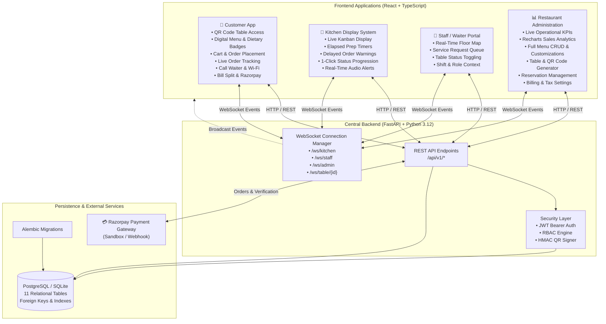

# Smart Restaurant Management Platform (SRMP)
### Enterprise Multi-Portal Hospitality Ecosystem

A unified, real-time restaurant management platform connecting **Customers**, **Kitchen Staff**, **Waiters**, and **Restaurant Administrators** through a single high-performance system.

Built from scratch using:
- **Frontend**: React 19, TypeScript, Vite, Tailwind CSS, Lucide Icons, Recharts, React Router
- **Backend**: Python 3.12, FastAPI, WebSockets, SQLAlchemy 2.0 ORM, Pydantic v2
- **Database**: PostgreSQL (Production) / SQLite (Local Fast-Boot), Alembic Migrations
- **Payment Gateway**: Razorpay (Sandbox & Production Webhooks)
- **Security**: JWT Authentication, Role-Based Access Control (RBAC), Cryptographic HMAC Table QR Tokens

---

## 🏛️ System Architecture



---

## 🚀 Quick Start Guide

### 1. Prerequisites
- **Node.js** (v18+)
- **Python** (v3.10+)

### 2. Backend Setup
```bash
cd backend

# Create virtual environment
python -m venv venv

# Activate virtual environment
# Windows:
.\venv\Scripts\activate
# Linux/macOS:
source venv/bin/activate

# Install dependencies
pip install -r requirements.txt

# Seed initial data (automatic on first run, or run manually)
python -m app.utils.seed_data

# Start FastAPI server
uvicorn app.main:app --host 0.0.0.0 --port 8000 --reload
```
API Documentation will be live at: `http://localhost:8000/docs`

### 3. Frontend Setup
```bash
cd frontend

# Install npm dependencies
npm install

# Start Vite development server
npm run dev
```
Frontend will be accessible at: `http://localhost:5173`

---

## 🔑 Development Seeding & Production Provisioning

- **Development / Local Demo (`ENVIRONMENT=development`)**: `python -m app.utils.seed_data` populates the sample *Royal Saffron* tenant without hardcoded passwords in application source. Passwords are read from `SUPERADMIN_INITIAL_PASSWORD` and `SEED_DEMO_*_PASSWORD` environment variables (or generated randomly per run with `must_change_password=true`).
- **Production (`ENVIRONMENT=production`)**: Demo seeding (`SEED_DEMO_DATA=true`) is disabled and rejected at startup; known demo fixture passwords and `@royalsaffron.com` fixture emails are blocked from authentication. Onboard real restaurant owners via `/register` or `/api/v1/onboarding/register`, and provision the platform super-admin with a strong random `SUPERADMIN_INITIAL_PASSWORD`.

| Role | Username | Access Rights |
|------|----------|---------------|
| **Platform Super Admin** | `superadmin` | Multi-tenant governance, platform subscriptions, billing overview |
| **Admin** | `admin` *(dev seed)* | Full administrative control, analytics, menu CRUD, settings |
| **Manager** | `manager` *(dev seed)* | Operations, table assignments, floor, reservations, menu |
| **Waiter** | `waiter` *(dev seed)* | Floor map, service requests, order assistance, bill delivery |
| **Kitchen** | `chef` *(dev seed)* | Kitchen Display System, preparation timers, status updates |
| **Cashier** | `cashier` *(dev seed)* | Billing settlements, cash/card payment records, receipts |

---

## 📱 Portals & Application Routes

- `/table/:qrToken` - **Customer Application** (Mobile-first QR dining experience)
- `/table/:qrToken/cart` - **Shopping Cart & Checkout**
- `/table/:qrToken/track/:orderId` - **Live Order Tracker**
- `/table/:qrToken/wifi` - **Guest Wi-Fi Connection Information**
- `/table/:qrToken/split-bill` - **Bill Splitting & Tip Calculator**
- `/table/:qrToken/service` - **Call Waiter & Service Requests**
- `/table/:qrToken/reserve` - **Table Reservation Request**
- `/kitchen` - **Kitchen Display System (KDS)**
- `/staff` - **Staff & Waiter Portal**
- `/admin` - **Restaurant Administration Hub**
  - `/admin/overview` - Dynamic Operational KPIs
  - `/admin/analytics` - Sales Trends & Category Charts
  - `/admin/menu` - Menu & Customizations Manager
  - `/admin/tables` - Floor Map & Table QR Generator
  - `/admin/staff` - Staff RBAC Management
  - `/admin/reservations` - Reservation Queue & Table Allocations
  - `/admin/billing` - Invoices, Taxes & Settlement Logs
  - `/admin/settings` - Restaurant Profile, Wi-Fi & GST Settings
- `/login` - **Staff Authentication Gateway**
- `/pricing`, `/terms`, `/privacy`, `/refund`, `/contact` - **Public Compliance & Transparent Pricing Pages**

---

## 💳 SaaS Subscription Pricing & Individual Business Operating Model

- **Operating Model:** `INDIVIDUAL_UNREGISTERED` (platform operated by an individual owner under the SRMP brand/trade name; legal owner name, bank reference, GST status, domain, and contact channels are environment-configurable and marked pending until verified).
- **Direct Tax-Inclusive Pricing:**
  - **Monthly Plan:** **₹999/month** (`99,900` integer paise) — inclusive of applicable taxes and compulsory charges.
  - **Yearly Plan:** **₹9,999/year** (`999,900` integer paise) — inclusive of applicable taxes and compulsory charges.
- **Tax Treatment:** While operating as an unregistered individual business (`IS_GST_REGISTERED=false`), GST is not collected and Non-GST Payment Receipts (`R{FY}/...`) are issued. If GST registration + CA confirmation are enabled in configuration (`IS_GST_REGISTERED=true`, `IS_GST_RATE_CA_CONFIRMED=true`), 18% GST is extracted inclusively (`84,661 + 15,239 = 99,900` monthly; `847,373 + 152,527 = 999,900` yearly) without ever increasing the advertised final price.
- **Dual-Flow Settlement Isolation:** Flow A restaurant customer dining payments settle strictly to each restaurant's own Razorpay merchant account; Flow B SaaS subscriptions settle strictly to the platform owner's configured merchant bank account. Online payment circuit breakers and live-mode payment flags fail closed by default (`FLOW_A_ENABLED=false`, `FLOW_B_ENABLED=false`, `LIVE_MODE_FLOW_A=false`, `LIVE_MODE_FLOW_B=false`, `EMERGENCY_DISABLE_PAYMENTS=true`, `DISABLE_RESTAURANT_PAYMENT_FALLBACK=true`).

---

## ☁️ Render Free-Tier Test Deployment Guide (Zero Paid Add-Ons)

For free testing (Firebase Hosting Spark frontend + Render Free Web Service + Render Free PostgreSQL):

1. **Service Configuration (`rootDir: backend`):**
   - **Plan:** `Free` (`plan: free` in [`render.yaml`](render.yaml))
   - **Runtime:** Python `3.12.10` (`PYTHON_VERSION=3.12.10`)
   - **Build Command:** `pip install -r requirements.txt`
   - **Start Command:** `alembic upgrade head && uvicorn app.main:app --host 0.0.0.0 --port $PORT --proxy-headers --forwarded-allow-ips='*' --ws-ping-interval 25 --ws-ping-timeout 60`
   - **Health Check Path:** `/health/ready`
2. **Free-Tier Operational Caveats:**
   - **No Pre-Deploy Command:** Render Free Web Services do not run `preDeployCommand`, so migrations run in `startCommand` via `alembic upgrade head && ...` (safe for PostgreSQL when no dangerous auto-`create_all` runs in production).
   - **Ephemeral Media Storage:** Set `STORAGE_BACKEND=local` so S3/R2 credentials are not required during free testing. **Files uploaded to `/static/uploads` on Render Free Web Services are stored on ephemeral container disk and will NOT persist across restarts, sleep, or redeploys.** Configure Cloudflare R2 or AWS S3 (`STORAGE_BACKEND=s3`) before production persistence.
   - **Free Database Retention & Cold Starts:** Render Free PostgreSQL instances expire after 30 days unless upgraded, and Free Web Services spin down after idle periods.
3. **Required Environment Variables (configure secrets directly in Render Dashboard — never commit secret values):**
   - **Required Runtime & Security:** `ENVIRONMENT=production`, `PYTHON_VERSION=3.12.10`, `DATABASE_URL` *(Internal Render Postgres URL)*, `SECRET_KEY` *(>=32 random URL-safe chars)*, `QR_SECRET` *(unique random secret)*, `SEED_DEMO_DATA=false`
   - **Required CORS & Frontend Origin:** `FRONTEND_URL=https://srmp-platform.web.app`, `BACKEND_CORS_ORIGINS=["https://srmp-platform.web.app","https://srmp-platform.firebaseapp.com"]`
   - **Required Safe Test Defaults (Payments Disabled & Local Storage):** `STORAGE_BACKEND=local`, `DISABLE_RESTAURANT_PAYMENT_FALLBACK=true`, `EMERGENCY_DISABLE_PAYMENTS=true`, `FLOW_A_ENABLED=false`, `FLOW_B_ENABLED=false`, `LIVE_MODE_FLOW_A=false`, `LIVE_MODE_FLOW_B=false`
   - **Optional (Leave Unset in Free Test Mode unless Configured):** `PLATFORM_RAZORPAY_KEY_ID`, `PLATFORM_RAZORPAY_KEY_SECRET`, `PLATFORM_RAZORPAY_WEBHOOK_SECRET`, `S3_*`, `RESEND_API_KEY`, `RESEND_FROM_EMAIL`, `SENTRY_DSN` (`ENABLE_TRANSACTIONAL_EMAIL=false`)
